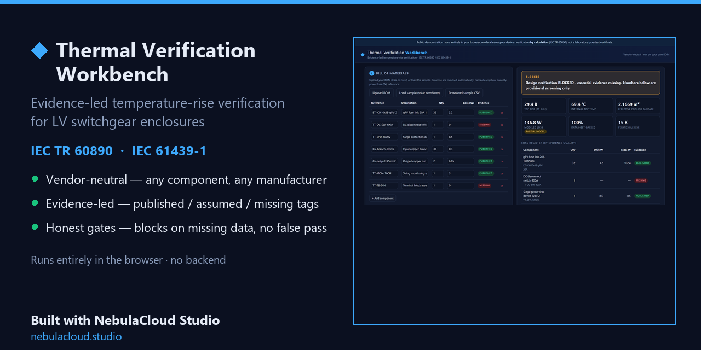

# Thermal Verification Workbench — Enclosure Temperature-Rise Verification by Calculation (IEC TR 60890 / IEC 61439-1)

> **Notice**
> This repository is a public project showcase created using NebulaCloud Studio.
> The proprietary source code, implementation details, prompts, workflows,
> datasets, infrastructure, and deployment configuration behind the broader
> NebulaCloud Studio platform are intentionally not included. The client-side
> calculation demo in this repository is published so the capability can be
> experienced directly.

## Overview

Thermal Verification Workbench is a browser-based tool that calculates the
air temperature rise inside a low-voltage switchgear or controlgear enclosure
and checks it against a permissible limit, using the temperature-rise
verification-by-calculation method of **IEC TR 60890** (the method referenced
by **IEC 61439-1** for design verification). It is vendor-neutral: any
component with a known power-loss value in watts can be used, regardless of
manufacturer.

The workbench demonstrates an evidence-led engineering workflow. Every
power-loss value is tagged by evidence quality (published, assumed, or
missing), and the verification **blocks** when essential data is absent
instead of presenting a confident-looking but unsupported result. It was
created using [NebulaCloud Studio](https://nebulacloud.studio).

## Live Demo

[](https://studio-public-demos.github.io/thermal-verification-workbench/)

**[▶ Open Live Demo](https://studio-public-demos.github.io/thermal-verification-workbench/)**

## What It Does

| Capability | Description |
|---|---|
| Bill-of-materials import | Reads a CSV or Excel (`.xlsx`) BOM in the browser; matches name/description, quantity, power-loss (W) and reference columns automatically, including common header variants. |
| Evidence classification | Tags each loss line as published (datasheet value), assumed (hand-entered), or missing (no value), and reports the datasheet-backed share of modeled loss. |
| Effective cooling surface | Computes the enclosure effective cooling surface `Ae` from external dimensions and the installation arrangement (surface weighting factors). |
| Temperature-rise calculation | Computes the internal air temperature rise at mid-height and at the top of the enclosure per IEC TR 60890, with enclosure constant `k`, distribution factor `c`, exponent, and a partition factor. |
| Design-verification gates | Blocks a "verified" verdict when the BOM is incomplete, when too little of the modeled loss is datasheet-backed, or when method applicability is not confirmed. |
| Cooling selection aid | Suggests a first-order filter-fan airflow when natural convection is insufficient (an engineering aid, not a certified result). |
| Printable report | Produces a clean, print-ready verification report with the loss register, gates, calculation basis, and limitations. |

## Why It Matters

Thermal checks for custom electrical assemblies usually depend on a specific
manufacturer's tool and catalogue. This workbench is vendor-neutral and runs
in any modern browser with no installation, so an engineer can try a bill of
materials and see a structured result immediately, and share the page with
colleagues or reviewers for interactive exploration.

The evidence-led design communicates uncertainty honestly. By separating
datasheet-backed values from assumptions and missing data, and by blocking a
result that cannot yet be supported, it makes a design review easier to trust
than a single pass/fail badge. That reduces the back-and-forth of clarifying
which numbers are real and which are placeholders.

It is a demonstration of a workflow, not a replacement for formal design
verification. Its value is faster concept demonstration, clearer technical
communication, and a shareable deliverable — not a substitute for a licensed
calculation or laboratory testing.

## Intended Users

| Audience | Relevant Application |
|---|---|
| Control-panel and switchgear builders | Early screening of enclosure temperature rise for a proposed bill of materials. |
| Electrical design engineers | Communicating a temperature-rise check with an explicit evidence trail. |
| Product and application engineers | Comparing enclosure sizing or ventilation options for a mixed-vendor assembly. |
| Technical reviewers | Reviewing which loss inputs are datasheet-backed versus assumed before sign-off. |

## Technical Highlights

| Capability | Technology or Method |
|---|---|
| Calculation engine | IEC TR 60890 verification-by-calculation method, implemented in vanilla JavaScript (ES modules). |
| Evidence model and gates | Client-side verification layer that classifies loss evidence and blocks unsupported verdicts. |
| BOM parsing | Dependency-free CSV parser; optional `.xlsx` parsing via the SheetJS library loaded from a CDN. |
| User interface | Static HTML and CSS, responsive desktop and mobile layouts, print stylesheet. |
| Deployment model | Fully static site; all computation runs in the browser with no backend. |

## Technical Scope & Limitations

- This is an interactive verification-by-calculation tool, **not** a laboratory
  type-test and **not** a certified compliance statement. The result is a
  calculation per IEC TR 60890, as referenced by IEC 61439-1.
- The table-driven factors (surface weighting factors, `k`/`c` curves) follow
  the published structure of the IEC TR 60890 method. The exact tabulated
  values are the property of the IEC and must be reconciled against the
  licensed standard text before any certified submission.
- The certified part of the method applies to enclosures **without forced
  ventilation** (natural convection). The cooling and heater suggestions are
  first-order engineering **selection aids** only and must be confirmed against
  the cooling/heater manufacturer's data.
- Results depend entirely on the bill of materials. Missing or assumed
  loss values are shown explicitly and will block a "verified" verdict; the
  modeled loss is not the assembly total when lines are missing or assumed.
- The bundled sample BOM is illustrative and must not be used for real design
  decisions.
- All computation is local to the browser; no bill-of-materials data is
  transmitted anywhere.

## Project Structure

```
/
├── index.html
├── README.md
├── LICENSE
├── ATTRIBUTIONS.md
├── .gitignore
├── css/
│   └── style.css
├── js/
│   ├── app.js           UI wiring and rendering
│   ├── engine.js        IEC TR 60890 calculation + cooling/heater aids
│   ├── verification.js  evidence model and design-verification gates
│   └── bom.js           CSV / worksheet parsing
├── assets/
│   ├── screenshot.png
│   └── social-preview.png
└── tools/               local-only asset-capture scripts (not part of the app)
    ├── capture.py
    └── social.py
```

## Quick Start

The app uses ES modules, so serve it over HTTP (do not open `index.html`
through `file://`).

```bash
git clone https://github.com/studio-public-demos/thermal-verification-workbench.git
cd thermal-verification-workbench
python -m http.server 8080
```

Then open:

```
http://localhost:8080
```

Click **Load sample (solar combiner)** to populate a bill of materials, then
**Calculate & verify**.

## Deployment

This project is deployed as a static site using **GitHub Pages** from the
default branch root.

Live demo: <https://studio-public-demos.github.io/thermal-verification-workbench/>

## Attribution

External components used by this showcase:

- **SheetJS (xlsx) Community Edition** — Apache-2.0, loaded from the jsDelivr
  CDN for optional Excel import.
- **IEC TR 60890** and **IEC 61439-1** — referenced standards, © International
  Electrotechnical Commission; not reproduced in this repository.

Full details, sources, and licences are in [ATTRIBUTIONS.md](ATTRIBUTIONS.md).

## Built with NebulaCloud Studio

This project was created using [NebulaCloud Studio](https://nebulacloud.studio), an agentic application-building platform for engineering, scientific, geospatial and interactive digital workflows.

NebulaCloud Studio helps domain professionals turn ideas, models, datasets and algorithms into usable, deployable applications.

## Build Your Own Interactive Application

Working with switchgear enclosures, electrical assemblies, or other engineering calculations?

Explore the live demo and see how your technical workflow could be transformed into an interactive application.

**[Explore NebulaCloud Studio](https://nebulacloud.studio)**

## Related Demos

Other public showcases from the [studio-public-demos](https://github.com/studio-public-demos) organization:

- Solar Combiner Thermal Engineering — evidence-led thermal study of a published DC combiner box.
- Additional engineering, geospatial, and interactive showcases are listed on the organization page.
